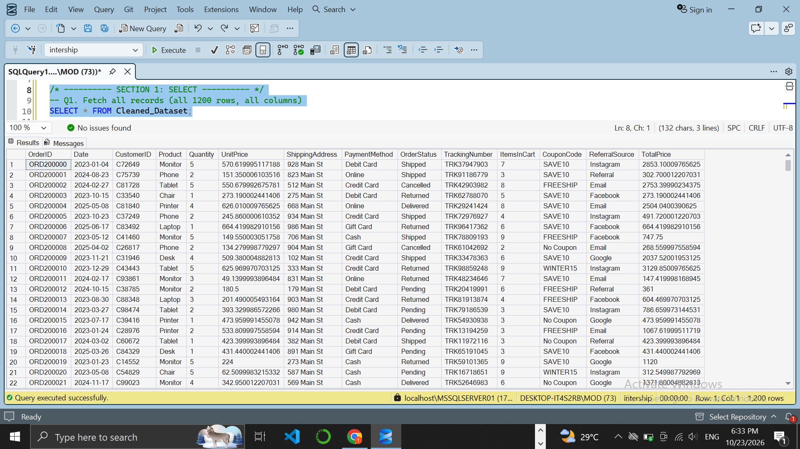
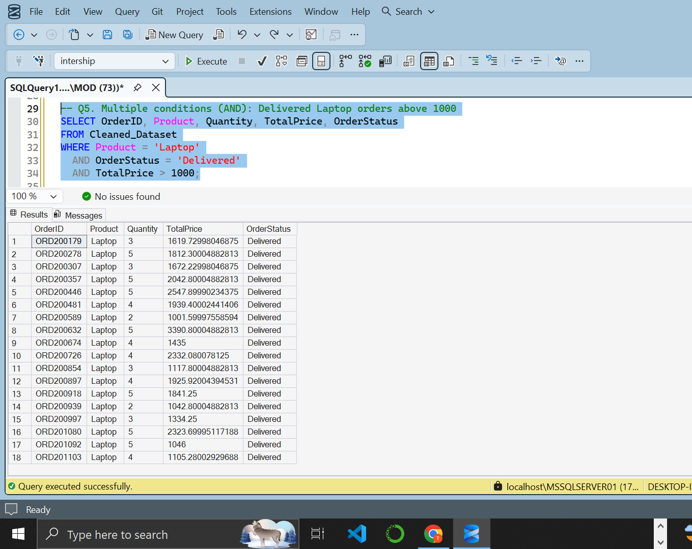
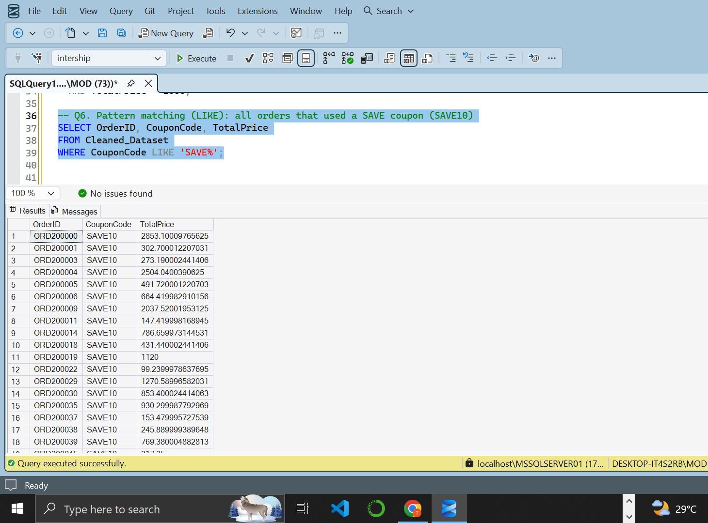
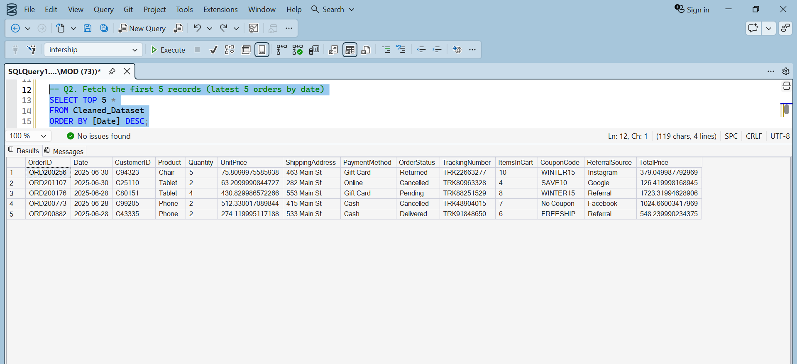

# SQL Data Analysis ( Project 3)

Extracting business insights from an e-commerce orders dataset using SQL Server.

## Dataset
`Cleaned_Dataset.csv` has 1,200 orders and 14 columns

## Skills Used
- `SELECT`, `TOP`, column aliases
- `WHERE` with equality, comparison, `AND` and `LIKE`
- `ORDER BY` (single and multiple columns)
- `GROUP BY` and `HAVING`
- Aggregations: `COUNT`, `SUM`, `AVG`, `MAX`, `MIN`
- Window function for percentage contribution (`SUM() OVER ()`)

## Files
- `Project3_SQL_Analysis.sql`: all queries with comments and expected results
- `Cleaned_Dataset.csv`: dataset
- `screenshots/`: query outputs from SQL Server Management Studio

## Key Insights
- Total revenue is about 1,264,762, with an average order value of about 1,054.
- Chair is the top-selling product by quantity (562 units) and Phone is the lowest (411 units).
- 497 of 1,200 orders (about 41%) were Cancelled or Returned, which points to a major area for improvement.
- Cancelled orders include high-value items: Chair (3,384.90), Tablet (3,370.20), Monitor (3,253.60) and Printer (3,215.15) each had a cancelled order above 3,215.

## Screenshots

### 1. SELECT Query

### 2. SELECT with WHERE

### 3. WHERE Clause

### 4. AND Operator

### 5. LIKE Operator

### 6. TOP Query

### 7. ORDER BY DESC

### 8. GROUP BY

### 9. GROUP BY with ORDER BY

### 10. GROUP BY with ORDER BY DESC

### 11. HAVING Clause

### 12. HAVING with COUNT

### 13. Aggregate Function - COUNT

### 14. Aggregate Functions - MAX and MIN

### 15. Percentage Contribution

## Tool
Microsoft SQL Server 
